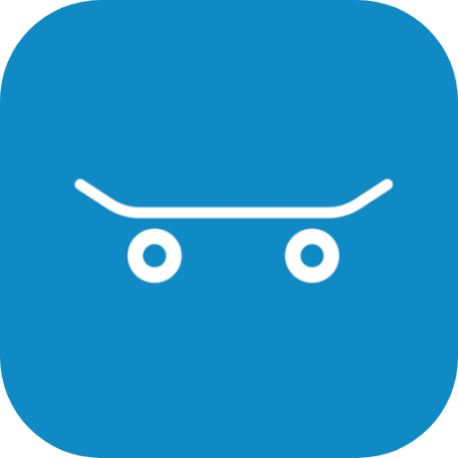

  <a href="https://skatedex.com">
    <picture>
      <source media="(prefers-color-scheme: dark)" srcset="brand/skatedex-lockup-dark.png">
      
    </picture>
  </a>

<h1 align="center">Kyle Niedzwiecki</h1>

  <strong>Cryptocurrency developer</strong> &nbsp;&middot;&nbsp; <strong>Investment group CTO</strong> &nbsp;&middot;&nbsp; <strong>Full-stack builder for operating businesses</strong> &nbsp;&middot;&nbsp; <strong>Skatepark liaison</strong> &nbsp;&middot;&nbsp; <strong>Founder of <a href="https://skatedex.com">Skatedex</a></strong>

  CTO at <a href="https://blackmountainig.com">Black Mountain Investment Group</a> &nbsp;&middot;&nbsp; <a href="https://kyers.com">Kyer's Reserve</a>

---

### Investment group CTO and fund tech

I run technology for Black Mountain Investment Group and the companies around it. That means the systems a fund actually operates on: fund administration and portfolio management (Easefolio), exchange and custody integrations, deal data rooms, investor sites, event and RSVP flows, a headless CMS, and the ledger that every trading strategy writes to. The fund's trading engine runs Wyckoff and PSAR strategies across a spot exchange and DEX pools with one ledger behind all of it.

### Cryptocurrency developer

Early Ethereum developer and memecoin developer. Trading systems and on-chain tooling: multi-venue trading engines, a memecoin scanner and scalper with honeypot simulation and launch detection across BNB Chain, Ethereum, Base, Ink and Robinhood Chain, exchange and wallet integrations, a GPU vanity address generator, network and canister monitoring for the Internet Computer, and crypto education and market data at Coinucation. Most of it is in the [Black Mountain Investment Group](https://github.com/Black-Mountain-Investment-Group) organization; the open parts are below.

### Full-stack builder for operating businesses

I build and run the web presence for real companies: investment firms, an energy exploration group, a roofing company, a holding company, a directory business. Next.js on Cloudflare Workers, server-rendered where it counts, with the forms, email, data and admin tooling each business needs behind it. Every one of these is live and operated by me:

| Site | What it is |
|---|---|
| [blackmountainig.com](https://blackmountainig.com) | Black Mountain Investment Group |
| [blackmountain.solutions](https://blackmountain.solutions) | Black Mountain Solutions: tech, growth and fund administration services |
| [easefolio.com](https://easefolio.com) | Easefolio: fund administration and portfolio management platform (web, desktop and mobile) |
| [aeriecg.com](https://aeriecg.com) | Aerie Capital Group: Salt Lake City commercial real estate investment firm |
| [kyers.com](https://kyers.com) | Kyer's Reserve: holding company |
| [skatedex.com](https://skatedex.com) | Skatedex: the largest skatepark directory on the web |
| [icpwatch.com](https://icpwatch.com) | ICPWatch: markets, network and canister health for the Internet Computer |
| [coinucation.com](https://coinucation.com) | Coinucation: crypto prices, data and plain-English education |
| [shootingranges.co](https://shootingranges.co) | ShootingRanges.co: 3,500+ ranges, gun clubs and gun shops |
| [hipterra.com](https://hipterra.com) | Hipterra: hydrocarbon exploration technology, plus its [document room](https://docs.hipterra.com) for e-signed agreements |
| [courtlandroofing.com](https://courtlandroofing.com) | Courtland Roofing |
| [anchormillgroup.com](https://anchormillgroup.com) | Anchor Mill Group |
| [0xCairn](https://0xcairn.kyleniedz99.workers.dev) | Vanity EVM address generator and cloud mining |

### AI agents

I build agents that operate real systems, not demos. [kcoder](https://github.com/kjniedz/kcoder) is my own terminal coding agent and the daemon that runs it. The trading engine's operator agent vets tokens, tunes parameters within bounds, watches for anomalies and writes the daily journal on its own cadence.

### Skatepark liaison

I keep the record of the world's skateparks current: new parks, rebuilds, closures, obstacles, photos and hours, for parks across the globe. Cities, builders and skaters send the updates and I make sure they land where skaters will find them.

### Founder of Skatedex

[Skatedex](https://skatedex.com) is the largest skatepark directory on the web: 8,600+ parks across the globe with photos, obstacles, directions and real skater reviews, on the web and in the mobile app. A community-powered platform for anyone who wants to find a new spot to skate.

 

### Open source

- [kcoder](https://github.com/kjniedz/kcoder): a terminal coding agent and the daemon that runs it.
- [ICPWatch](https://github.com/kjniedz/ICPWatch): markets, network and canister health for the Internet Computer. One Cloudflare Worker: Hono SSR, D1, cron collectors, and a Lifeline monitor that reads cycle balances through every public path the IC offers.
- [0xCairn](https://github.com/kjniedz/0xCairn): vanity address generator for every EVM chain. Rust compiled to WASM plus a WebGPU kernel, entirely in the browser, with a cloud mining service designed so the service can never learn your key.

---

  <a href="https://skatedex.com">skatedex.com</a> &nbsp;&middot;&nbsp; <a href="https://blackmountainig.com">blackmountainig.com</a> &nbsp;&middot;&nbsp; <a href="https://kyers.com">kyers.com</a>

